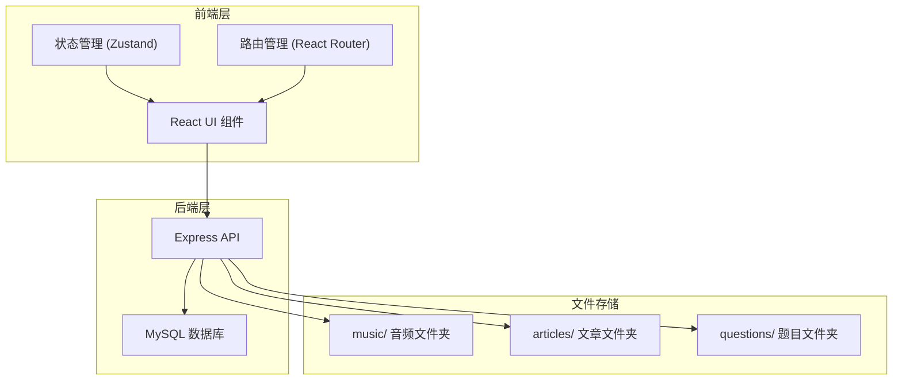

## 1. 架构设计



## 2. 技术说明

- **前端框架**：React@18 + TypeScript
- **样式方案**：Tailwind CSS@3
- **构建工具**：Vite
- **路由管理**：React Router@6
- **状态管理**：Zustand
- **后端框架**：Express@4 + TypeScript
- **数据库**：MySQL 8.0+
- **文件存储**：本地文件系统
  - `music/`：存储音频文件
  - `articles/`：存储文章文件
  - `questions/`：存储题目文件

## 3. 路由定义

| 路由 | 用途 |
|------|------|
| `/` | 首页，展示学习进度和快捷入口 |
| `/vocabulary` | 单词本页面，单词列表和管理 |
| `/vocabulary/test` | 单词记忆测试页面 |
| `/listening` | 听力训练页面，录音列表 |
| `/reading` | 阅读理解页面，文章列表 |
| `/reading/:id` | 文章阅读页面 |
| `/reading/:id/test` | 阅读理解测试页面 |

## 4. API 接口定义

### 4.1 单词接口

| 方法 | 路径 | 描述 |
|------|------|------|
| GET | `/api/words` | 获取所有单词 |
| POST | `/api/words` | 添加新单词 |
| PUT | `/api/words/:id` | 更新单词 |
| DELETE | `/api/words/:id` | 删除单词 |

### 4.2 音频接口

| 方法 | 路径 | 描述 |
|------|------|------|
| GET | `/api/audios` | 获取所有音频列表 |
| POST | `/api/audios` | 上传音频文件 |
| DELETE | `/api/audios/:id` | 删除音频 |

### 4.3 文章接口

| 方法 | 路径 | 描述 |
|------|------|------|
| GET | `/api/articles` | 获取所有文章列表 |
| POST | `/api/articles` | 导入文章 |
| GET | `/api/articles/:id` | 获取文章详情 |
| DELETE | `/api/articles/:id` | 删除文章 |

### 4.4 题目接口

| 方法 | 路径 | 描述 |
|------|------|------|
| GET | `/api/questions/:articleId` | 获取文章的题目 |
| POST | `/api/questions` | 导入题目 |
| DELETE | `/api/questions/:id` | 删除题目 |

## 5. 数据库表结构

### 5.1 words 表

| 字段名 | 类型 | 说明 |
|--------|------|------|
| id | INT | 主键，自增 |
| word | VARCHAR(100) | 英文单词 |
| phonetic | VARCHAR(50) | 音标 |
| meaning | TEXT | 中文释义 |
| example | TEXT | 例句 |
| status | ENUM | 状态：new/learning/mastered |
| created_at | DATETIME | 创建时间 |
| last_reviewed_at | DATETIME | 最后复习时间 |
| review_count | INT | 复习次数 |

### 5.2 audios 表

| 字段名 | 类型 | 说明 |
|--------|------|------|
| id | INT | 主键，自增 |
| title | VARCHAR(200) | 音频标题 |
| category | VARCHAR(50) | 分类 |
| duration | INT | 时长（秒） |
| file_path | VARCHAR(500) | 文件路径 |
| created_at | DATETIME | 创建时间 |

### 5.3 articles 表

| 字段名 | 类型 | 说明 |
|--------|------|------|
| id | INT | 主键，自增 |
| title | VARCHAR(200) | 文章标题 |
| content | TEXT | 文章内容 |
| difficulty | ENUM | 难度：easy/medium/hard |
| word_count | INT | 单词数 |
| file_path | VARCHAR(500) | 文件路径 |
| created_at | DATETIME | 创建时间 |

### 5.4 questions 表

| 字段名 | 类型 | 说明 |
|--------|------|------|
| id | INT | 主键，自增 |
| article_id | INT | 关联文章 ID |
| question | TEXT | 问题内容 |
| options | TEXT | 选项（JSON 数组） |
| correct_answer | INT | 正确答案索引 |
| explanation | TEXT | 解析 |
| created_at | DATETIME | 创建时间 |

### 5.5 study_records 表

| 字段名 | 类型 | 说明 |
|--------|------|------|
| id | INT | 主键，自增 |
| date | DATE | 日期 |
| words_learned | INT | 学习单词数 |
| listening_minutes | INT | 听力时长（分钟） |
| articles_read | INT | 阅读篇数 |

## 6. 项目结构

```
english-web/
├── api/                    # 后端代码
│   ├── src/
│   │   ├── controllers/    # 控制器
│   │   ├── routes/         # 路由
│   │   ├── models/         # 数据库模型
│   │   ├── config/         # 配置文件
│   │   └── server.ts       # 服务器入口
│   └── package.json
├── music/                  # 音频文件存储
├── articles/               # 文章文件存储
├── questions/              # 题目文件存储
├── public/
├── src/
│   ├── components/         # 可复用组件
│   ├── pages/              # 页面组件
│   ├── hooks/              # 自定义 Hooks
│   ├── store/              # Zustand 状态管理
│   ├── types/              # TypeScript 类型定义
│   └── utils/              # 工具函数
├── index.html
├── package.json
├── tailwind.config.js
└── vite.config.ts
```

## 7. 核心功能实现方案

### 7.1 音频上传

- 使用 multer 中间件处理文件上传
- 文件存储到 `music/` 文件夹
- 支持 MP3、WAV、OGG 格式

### 7.2 文章导入

- 支持 Markdown 和纯文本格式
- 文件存储到 `articles/` 文件夹
- 自动统计单词数

### 7.3 题目导入

- 支持 JSON 格式导入
- 文件存储到 `questions/` 文件夹
- 每道题目包含选项和正确答案

### 7.4 MySQL 连接

- 使用 mysql2 库连接 MySQL
- 配置文件存储数据库连接信息
- 使用连接池提高性能

### 7.5 考研英语专用

- 预置考研英语词汇和文章
- 难度分级适配考研水平
- 支持真题导入
